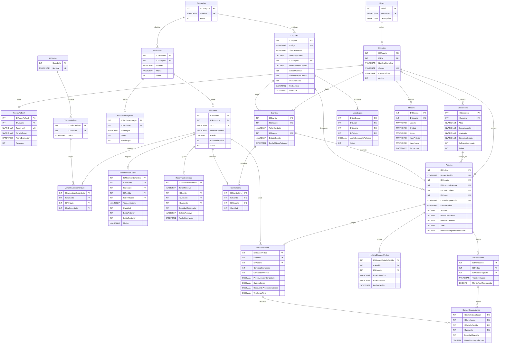
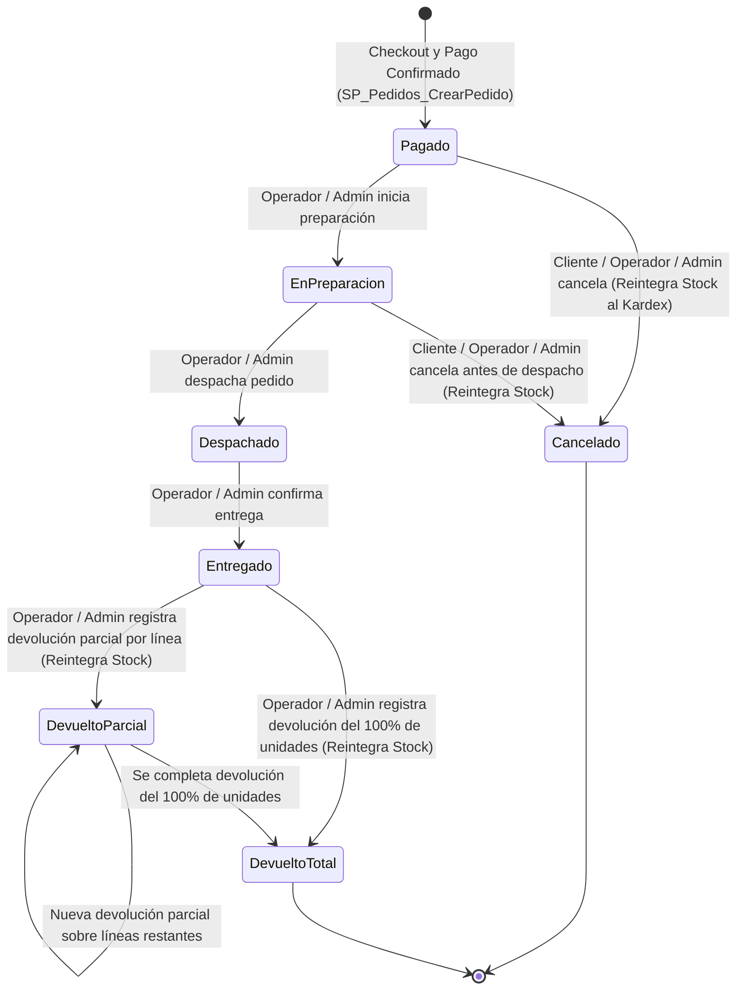

# ShopCart — Plataforma Web de Ventas (Tech Challenge 360 · Grupo Pentandra / Don Arturo)

Plataforma de comercio electrónico de nivel productivo diseñada bajo una arquitectura estricta orientada a la integridad transaccional en **Microsoft SQL Server 2019/2022** (con acceso **100% mediante Stored Procedures**) y **Backend en Capas con Node.js 24 LTS + TypeScript (`strict`) + Express**.

---

## Tabla de Contenidos
1. [Requisitos Previos e Instalación en Máquina Limpia](#1-requisitos-previos-e-instalación-en-máquina-limpia)
2. [Credenciales de Prueba y Datos Semilla](#2-credenciales-de-prueba-y-datos-semilla)
3. [Arquitectura del Sistema y Justificación de Decisiones Técnicas](#3-arquitectura-del-sistema-y-justificación-de-decisiones-técnicas)
4. [Diagrama Entidad-Relación (ER) y Estándares de Base de Datos](#4-diagrama-entidad-relación-er-y-estándares-de-base-de-datos)
5. [Ciclo de Vida del Pedido y Diagrama de Estados (RF-07)](#5-ciclo-de-vida-del-pedido-y-diagrama-de-estados-rf-07)
6. [Decisiones Abiertas Documentadas (Sección 6 del Reto)](#6-decisiones-abiertas-documentadas-sección-6-del-reto)
7. [Defensa Técnica: Concurrencia, Idempotencia e Integridad](#7-defensa-técnica-concurrencia-idempotencia-e-integridad)
8. [Catálogo Completo de Endpoints REST API y Stored Procedures](#8-catálogo-completo-de-endpoints-rest-api-y-stored-procedures)

---

## 1. Requisitos Previos e Instalación en Máquina Limpia

### Requisitos del Sistema
* **Docker Desktop** (para levantar Microsoft SQL Server 2022) o una instancia local/remota de **SQL Server 2019 o superior**.
* **Node.js 24 LTS** o superior.

### Instalación y Ejecución Paso a Paso

```bash
# 1. Crear archivo de variables de entorno a partir de la plantilla
cp .env.example .env

# 2. Levantar el contenedor de Microsoft SQL Server 2022
docker compose up -d

# 3. Ejecutar los 11 scripts SQL numerados (Esquema, Constraints, Índices, Triggers, Vistas, Funciones, SPs y Semillas)
./database/run-migrations.sh

# (Opcional) Si desea recrear la base de datos desde cero en cualquier momento:
./database/run-migrations.sh --reset

# 4. Instalar dependencias del Backend e iniciar el servidor en modo desarrollo
cd backend
npm install
npm run dev
```

* **Healthcheck del API:** `http://localhost:4000/api/health`
* **Documentación de Endpoints:** `http://localhost:4000/api/docs`

### Ejecución de la Suite Automatizada de Pruebas (`RF-01` a `RF-09`)
Para verificar automáticamente todos los criterios de aceptación (incluyendo concurrencia por la última unidad, idempotencia por doble clic, protección anti-IDOR `403`, expiración de token `401`, cupones, devoluciones y rendimiento `< 1s` del dashboard):

```bash
cd backend
npm run test:integration
```

---

## 2. Credenciales de Prueba y Datos Semilla

Todas las contraseñas en la base de datos están cifradas con `bcrypt` (`10` salt rounds):

| Rol | Correo Electrónico | Contraseña | Nombre | Propósito de Prueba |
| :--- | :--- | :--- | :--- | :--- |
| **Administrador** | `admin@shopcart.com.gt` | `Admin123!` | Arturo Castillo | Acceso total: catálogo, precios, inventario, cupones, usuarios, dashboard y bitácora |
| **Operador** | `operador@shopcart.com.gt` | `Operador123!` | Sofía Morales | Gestión de pedidos (estados y devoluciones) e inventario/kardex |
| **Cliente 1** | `cliente@shopcart.com.gt` | `Cliente123!` | Jorge López | Cliente con pedidos entregados, cancelados y direcciones en Zona 10 y Zona 14 |
| **Cliente 2** | `maria.garcia@correo.gt` | `Cliente123!` | María Fernanda García | Cliente con pedido en devolución parcial, pedido pagado hoy y dirección en Antigua |
| **Cliente 3** | `carlos.mendez@correo.gt` | `Cliente123!` | Carlos Eduardo Méndez | Cliente con pedido en preparación y carrito abandonado activo |
| **Cliente Inactivo** | `inactivo@correo.gt` | `Cliente123!` | Roberto Pérez | Cuenta con `Activo = 0` para verificar bloqueo de login y renovación (`RF-01`) |

### Cupones Semilla Disponibles (`RF-05`)
* `BIENVENIDA10`: **10% de descuento** aplicable a todo el carrito (compra mínima `Q150.00`, límite total `100`, límite por cliente `2`).
* `QUETZAL50`: **Q50.00 de descuento fijo** aplicable a todo el carrito (compra mínima `Q300.00`, límite total `50`, límite por cliente `1`).
* `MODA20`: **20% de descuento** exclusivo para la categoría **Ropa y Moda** (compra mínima `Q200.00`).
* `ULTIMO1`: **Q25.00 de descuento fijo** con `LimiteUsoTotal = 1` (para probar acceso concurrente al último uso de un cupón).
* `VENCIDO2025`: Cupón con fecha de vigencia vencida (para verificar mensaje específico de rechazo).

---

## 3. Arquitectura del Sistema y Justificación de Decisiones Técnicas

### Estructura del Repositorio

```text
.
├── .env.example                           # Plantilla de variables de entorno (sin secretos)
├── docker-compose.yml                     # Contenedor Microsoft SQL Server 2022 Developer
├── README.md                              # Documentación general, diagramas y decisiones técnicas
├── database/                              # Scripts SQL versionados, numerados y reproducibles
│   ├── 01_Database_And_Config.sql         # Creación de ShopCartDB, READ_COMMITTED_SNAPSHOT y ConfiguracionSistema
│   ├── 02_Tables_And_Constraints.sql      # 25 tablas normalizadas en 3FN con PK, FK, UNIQUE, CHECK y DEFAULT
│   ├── 03_Indexes.sql                     # Índices compuestos y filtrados para consultas < 1 segundo
│   ├── 04_Triggers_Inmutabilidad.sql      # Triggers INSTEAD OF UPDATE, DELETE en Bitácora, Kardex e Historial
│   ├── 05_Functions_And_Views.sql         # 4 Funciones Tipo Tabla (FU_) y 5 Vistas (VW_)
│   ├── 06_SP_Auth_Usuarios_Direcciones.sql# 15 Stored Procedures para RF-01 (Auth, Tokens, Usuarios, Direcciones)
│   ├── 07_SP_Catalogo_Inventario.sql      # 16 Stored Procedures para RF-02 y RF-03 (Catálogo, Kardex, Reservas)
│   ├── 08_SP_Carrito_Cupones.sql          # 10 Stored Procedures para RF-04 y RF-05 (Carrito, Fusión y Cupones)
│   ├── 09_SP_Pedidos_Devoluciones.sql     # 5 Stored Procedures para RF-06 y RF-07 (Checkout, Estados, Devoluciones)
│   ├── 10_SP_Dashboard_Bitacora.sql       # 3 Stored Procedures para RF-08 y RF-09 (Dashboard y Bitácora)
│   ├── 11_Seed_Data.sql                   # Datos semilla completos en Quetzales (GTQ) con IVA 12%
│   └── run-migrations.sh                  # Script automatizado para ejecutar los 11 archivos en orden
└── backend/                               # API REST en Node.js 24 + TypeScript (strict) + Express
    ├── package.json
    ├── tsconfig.json
    ├── src/
    │   ├── config/                        # Validación de entorno (env.ts) y pool mssql (database.ts)
    │   ├── middlewares/                   # Auth JWT (401/403), validación Zod (400) y errorHandler centralizado
    │   ├── repositories/                  # Capa de Acceso a Datos (invoca exclusivamente Stored Procedures)
    │   ├── services/                      # Capa de Lógica de Negocio (Auth, Catálogo, Carrito, Pedidos/Dashboard)
    │   ├── controllers/                   # Capa HTTP (sin lógica de negocio)
    │   ├── routes/                        # Definición de endpoints REST y esquemas de validación
    │   └── utils/                         # AppError, asyncHandler y caché/SSE del Dashboard
    └── tests/
        └── integration.test.ts            # Suite automatizada de pruebas de integración y concurrencia
```

### Justificación de Librerías Elegidas
1. **`mssql` (Driver nativo sin ORM):** Cumple la restricción obligatoria de no utilizar ningún ORM ni consultas SQL embebidas. Se encapsuló en `executeStoredProcedure()`, que valida por expresión regular que solo se ejecuten objetos `dbo.SP_*` con parámetros tipados (`request.input()`).
2. **`zod`:** Garantiza que ningún payload malformado llegue a la capa de servicios o a la base de datos, devolviendo mensajes de validación claros por campo.
3. **`jsonwebtoken` + `bcryptjs`:** Implementa tokens de acceso JWT de corta duración (`15m`) y Refresh Tokens rotativos almacenados como hashes SHA-256 en SQL Server.
4. **`helmet`, `cors` y `express-rate-limit`:** Cumplen los requerimientos no funcionales de seguridad y el extra opcional de *Rate Limiting* en los endpoints de autenticación.

---

## 4. Diagrama Entidad-Relación (ER) y Estándares de Base de Datos

El modelo de datos cuenta con **25 tablas en Tercera Forma Normal (3FN)**:
* **Cero `FLOAT` o `REAL`:** Todos los montos en Quetzales (`GTQ`) usan `DECIMAL(12, 2)`, los porcentajes usan `DECIMAL(5, 2)` y las cantidades usan `INT`.
* **Estándar de Nomenclatura (Sección 5):**
  * **Llave primaria autoincrementable:** `ID` + `NombreEntidad` (`IDProducto`, `IDCarrito`, `IDPedido`, `IDCupon`, etc.).
  * **Stored Procedures:** `SP_Modulo_Proceso` (ej. `SP_Pedidos_CrearPedido`, `SP_Inventario_ReservarExistencia`).
  * **Vistas:** `VW_Modulo_Proceso` (ej. `VW_Dashboard_VentasPorCategoria`, `VW_Pedidos_Historial`).
  * **Funciones Tipo Tabla:** `FU_Modulo_Proceso` (ej. `FU_Cupones_CalculoDescuento`, `FU_Catalogo_PrecioVigente`).



---

## 5. Ciclo de Vida del Pedido y Diagrama de Estados (RF-07)

El ciclo de vida del pedido está definido y blindado en la base de datos mediante la tabla de reglas `dbo.TransicionesEstadoPedido` y los procedimientos `SP_Pedidos_CambiarEstado` y `SP_Pedidos_RegistrarDevolucion`:



| Estado Origen | Estado Destino | Roles Permitidos | Efecto en Inventario (Kardex) y Reportes |
| :--- | :--- | :--- | :--- |
| `Pagado` | `EnPreparacion` | `Operador`, `Administrador` | Sin movimiento adicional (stock ya descontado al crear el pedido). |
| `Pagado` | `Cancelado` | `Cliente`, `Operador`, `Administrador` | Reintegra el 100% de unidades en `MovimientosKardex` (`REINGRESO_CANCELACION`), libera el cupón y excluye el pedido de reportes de ventas. |
| `EnPreparacion` | `Despachado` | `Operador`, `Administrador` | El pedido sale a ruta; a partir de este punto **ya no puede cancelarse**. |
| `EnPreparacion` | `Cancelado` | `Cliente`, `Operador`, `Administrador` | Reintegra el 100% de unidades en `MovimientosKardex` (`REINGRESO_CANCELACION`), libera el cupón y excluye el pedido de reportes. |
| `Despachado` | `Entregado` | `Operador`, `Administrador` | Pedido entregado al cliente; habilita la posibilidad de devoluciones parciales o totales. |
| `Entregado` | `DevueltoParcial` / `DevueltoTotal` | `Operador`, `Administrador` | Reintegra las unidades devueltas en `MovimientosKardex` (`DEVOLUCION_CLIENTE`) y descuenta el monto neto reintegrado en los reportes del Dashboard. |
| `DevueltoParcial`| `DevueltoParcial` / `DevueltoTotal` | `Operador`, `Administrador` | Permite devolver unidades restantes sin superar jamás `CantidadComprada` por línea. |

---

## 6. Decisiones Abiertas Documentadas (Sección 6 del Reto)

| Código | Decisión Abierta del Enunciado | Postura Técnica Adoptada e Implementada |
| :---: | :--- | :--- |
| **DA-01** | **Fusión del Carrito de Invitado (`TokenInvitado`) al iniciar sesión** | Un visitante sin sesión opera su carrito enviando el header `x-guest-token`. Al iniciar sesión o registrarse, `SP_Carrito_FusionarInvitado` transfiere sus productos al carrito del usuario autenticado (topando la cantidad de cada variante a su `ExistenciaDisponible` real) y marca el carrito invitado como `'FUSIONADO'`. |
| **DA-02** | **Cálculo de reintegros en devoluciones cuando el pedido usó un cupón** | Al confirmar el pedido en `SP_Pedidos_CrearPedido`, el descuento del cupón se prorratea proporcionalmente entre las líneas elegibles (`DescuentoProporcionalLinea` y `TotalLineaNeto`), ajustando cualquier residuo de `Q0.01` en la línea de mayor importe. Al devolver parcial o totalmente una línea, se reintegra exactamente el precio neto pagado por unidad. |
| **DA-03** | **Política de uso de cupón cuando un pedido se cancela antes de despacho** | Si un pedido se cancela antes de ser despachado (`Pagado` o `EnPreparacion` -> `Cancelado`), el SP desactiva el registro en `UsosCupon` y decrementa `Cupones.UsosActuales` para que el cliente no pierda su beneficio. En devoluciones post-entrega, el cupón se mantiene consumido. |
| **DA-04** | **Flujo de Checkout en 2 pasos (Reserva de 15 minutos + Confirmación de Pago)** | **Paso 1 (`POST /api/checkout/reserve` -> `SP_Inventario_ReservarExistencia`):** Aparta las unidades durante 15 minutos con bloqueo pesimista y devuelve un `TokenReserva` y su `FechaExpiracion`. **Paso 2 (`POST /api/checkout/confirm` -> `SP_Pedidos_CrearPedido`):** Verifica la vigencia del `TokenReserva` y la `ClaveIdempotencia`, consume la reserva y crea el pedido atómicamente. |
| **DA-05** | **Definición de "Pedidos Completados" en los Reportes (`RF-08`)** | Los reportes del Dashboard consideran todos los pedidos con pago confirmado que no estén cancelados (`EstadoPedido <> 'Cancelado'`), restando de las ventas brutas y netas tanto los descuentos aplicados como el `MontoReintegradoAcumulado` de devoluciones parciales o totales. |
| **DA-06** | **Simulación de Pasarela de Pagos** | El endpoint `POST /api/checkout/confirm` incluye soporte para simular rechazos de cobro (`simularFalloPago: true`), devolviendo HTTP `402 Payment Required` sin crear el pedido ni descontar stock del Kardex, manteniendo la reserva activa por los minutos restantes. |

---

## 7. Defensa Técnica: Concurrencia, Idempotencia e Integridad

1. **Cero Sobreventa bajo Acceso Simultáneo (`RF-06`):**
   * En `SP_Inventario_ReservarExistencia` y `SP_Pedidos_CrearPedido`, las filas de `dbo.Variantes` se leen y actualizan dentro de una transacción explícita (`SET XACT_ABORT ON`, `BEGIN TRAN`) utilizando el table hint `WITH (UPDLOCK, HOLDLOCK)` y ordenando siempre por `IDVariante ASC`.
   * Cuando dos clientes intentan comprar la última unidad al mismo milisegundo, el primer proceso adquiere el `UPDLOCK` sobre la variante, registra la reserva y hace `COMMIT`; el segundo proceso lee inmediatamente la nueva `ExistenciaDisponible = 0`, hace `ROLLBACK` y recibe HTTP `409 Conflict` con un mensaje claro.
2. **Idempotencia Garantizada en Base de Datos (`RF-06`):**
   * La tabla `dbo.Pedidos` posee el constraint `UQ_Pedidos_ClaveIdempotencia`. Si el cliente presiona dos veces el botón de pagar o reintenta la petición tras un corte de red con la misma `ClaveIdempotencia`, `SP_Pedidos_CrearPedido` detecta el pedido previamente creado y devuelve exactamente el mismo objeto sin generar un segundo pedido ni un segundo descuento de inventario.
3. **Liberación Automática de Reservas de 15 Minutos (`RF-07`):**
   * La función `FU_Catalogo_PrecioVigente` calcula las unidades reservadas filtrando `EstadoReserva = 'ACTIVA' AND FechaExpiracion > SYSDATETIME()`. Gracias a ello, en el instante exacto en que se cumplen los 15 minutos, la existencia queda disponible automáticamente sin depender de intervención manual, complementándose con un proceso periódico cada 60 segundos que ejecuta `SP_Inventario_LiberarReservasVencidas`.
4. **Inmutabilidad de Bitácora y Kardex (`RF-03` y `RF-09`):**
   * Los triggers `TR_Bitacora_BloquearModificacionYEliminacion`, `TR_MovimientosKardex_BloquearModificacionYEliminacion` y `TR_HistorialEstadosPedido_BloquearModificacionYEliminacion` interceptan cualquier `UPDATE` o `DELETE` con `INSTEAD OF` y lanzan `THROW 50099`.

---

## 8. Catálogo Completo de Endpoints REST API y Stored Procedures

| Módulo | Método y Endpoint | Roles | Stored Procedure Invocado |
| :--- | :--- | :--- | :--- |
| **RF-01 Auth** | `POST /api/auth/register` | Público | `SP_Auth_RegistrarCliente` + `SP_Carrito_FusionarInvitado` |
| **RF-01 Auth** | `POST /api/auth/login` | Público | `SP_Auth_ObtenerUsuarioPorCorreo` + `SP_Auth_GuardarRefreshToken` |
| **RF-01 Auth** | `POST /api/auth/refresh` | Público | `SP_Auth_RotarRefreshToken` |
| **RF-01 Auth** | `POST /api/auth/logout` | Público / Auth | `SP_Auth_RevocarRefreshToken` |
| **RF-01 Auth** | `GET /api/auth/me` | Autenticado | `SP_Usuarios_ObtenerPorID` |
| **RF-01 Auth** | `POST /api/auth/deactivate-self` | Autenticado | `SP_Usuarios_CambiarEstadoActivo` |
| **RF-01 Usuarios** | `GET /api/users` | `Administrador` | `SP_Usuarios_Listar` |
| **RF-01 Usuarios** | `POST /api/users` | `Administrador` | `SP_Usuarios_CrearInterno` |
| **RF-01 Usuarios** | `PUT /api/users/:id` | `Administrador` | `SP_Usuarios_Actualizar` |
| **RF-01 Usuarios** | `PATCH /api/users/:id/status` | `Administrador` | `SP_Usuarios_CambiarEstadoActivo` |
| **RF-01 Direcciones** | `GET /api/addresses` | `Cliente` | `SP_Direcciones_ListarPorCliente` |
| **RF-01 Direcciones** | `GET /api/addresses/:id` | `Cliente` (Dueño) | `SP_Direcciones_ObtenerPorID` |
| **RF-01 Direcciones** | `POST /api/addresses` | `Cliente` | `SP_Direcciones_Crear` |
| **RF-01 Direcciones** | `PUT /api/addresses/:id` | `Cliente` (Dueño) | `SP_Direcciones_Actualizar` |
| **RF-01 Direcciones** | `DELETE /api/addresses/:id` | `Cliente` (Dueño) | `SP_Direcciones_Eliminar` |
| **RF-02 Catálogo** | `GET /api/categories` | Público | `SP_Catalogo_ListarCategorias` |
| **RF-02 Catálogo** | `POST /api/categories` | `Administrador` | `SP_Catalogo_CrearCategoria` |
| **RF-02 Catálogo** | `PUT /api/categories/:id` | `Administrador` | `SP_Catalogo_ActualizarCategoria` |
| **RF-02 Catálogo** | `GET /api/attributes` | Público | `SP_Catalogo_ListarAtributos` |
| **RF-02 Catálogo** | `POST /api/attributes` | `Administrador` | `SP_Catalogo_GuardarAtributoYValor` |
| **RF-02 Catálogo** | `GET /api/products` | Público | `SP_Catalogo_ListarProductos` |
| **RF-02 Catálogo** | `GET /api/products/:id` | Público | `SP_Catalogo_ObtenerProductoDetalle` |
| **RF-02 Catálogo** | `POST /api/products` | `Administrador` | `SP_Catalogo_CrearProducto` |
| **RF-02 Catálogo** | `PUT /api/products/:id` | `Administrador` | `SP_Catalogo_ActualizarProducto` |
| **RF-02 Catálogo** | `DELETE /api/products/:id` | `Administrador` | `SP_Catalogo_EliminarODesactivarProducto` |
| **RF-02 Variantes** | `POST /api/products/:idProducto/variants` | `Administrador` | `SP_Catalogo_GuardarVariante` |
| **RF-02 Variantes** | `PUT /api/products/:idProducto/variants/:idVariante` | `Administrador` | `SP_Catalogo_GuardarVariante` |
| **RF-03 Inventario** | `GET /api/inventory/stock` | `Operador`, `Admin` | `SP_Inventario_ObtenerExistencias` |
| **RF-03 Inventario** | `GET /api/inventory/kardex` | `Operador`, `Admin` | `SP_Inventario_ConsultarKardex` |
| **RF-03 Inventario** | `POST /api/inventory/movements` | `Operador`, `Admin` | `SP_Inventario_RegistrarMovimiento` |
| **RF-03 Inventario** | `POST /api/inventory/release-expired` | `Operador`, `Admin` | `SP_Inventario_LiberarReservasVencidas` |
| **RF-04 Carrito** | `GET /api/cart` | Público / `Cliente` | `SP_Carrito_ObtenerDetalle` |
| **RF-04 Carrito** | `POST /api/cart/items` | Público / `Cliente` | `SP_Carrito_AgregarOModificarItem` |
| **RF-04 Carrito** | `PUT /api/cart/items` | Público / `Cliente` | `SP_Carrito_AgregarOModificarItem` |
| **RF-04 Carrito** | `DELETE /api/cart/items/:idVariante` | Público / `Cliente` | `SP_Carrito_EliminarItem` |
| **RF-04 Carrito** | `DELETE /api/cart` | Público / `Cliente` | `SP_Carrito_Vaciar` |
| **RF-04 Carrito** | `POST /api/cart/merge` | `Cliente` | `SP_Carrito_FusionarInvitado` |
| **RF-05 Cupones** | `POST /api/cart/coupon` | Público / `Cliente` | `SP_Carrito_AplicarCupon` |
| **RF-05 Cupones** | `DELETE /api/cart/coupon` | Público / `Cliente` | `SP_Carrito_RemoverCupon` |
| **RF-05 Cupones** | `GET /api/coupons` | `Administrador` | `SP_Cupones_Listar` |
| **RF-05 Cupones** | `GET /api/coupons/:id` | `Administrador` | `SP_Cupones_ObtenerPorID` |
| **RF-05 Cupones** | `POST /api/coupons` | `Administrador` | `SP_Cupones_Guardar` |
| **RF-05 Cupones** | `PUT /api/coupons/:id` | `Administrador` | `SP_Cupones_Guardar` |
| **RF-06 Checkout** | `POST /api/checkout/reserve` | `Cliente` | `SP_Inventario_ReservarExistencia` |
| **RF-06 Checkout** | `POST /api/checkout/confirm` | `Cliente` | `SP_Pedidos_CrearPedido` |
| **RF-07 Pedidos** | `GET /api/orders` | Autenticado | `SP_Pedidos_Listar` |
| **RF-07 Pedidos** | `GET /api/orders/:id` | Dueño / `Op` / `Admin` | `SP_Pedidos_ObtenerDetalle` |
| **RF-07 Pedidos** | `PATCH /api/orders/:id/state` | Dueño / `Op` / `Admin` | `SP_Pedidos_CambiarEstado` |
| **RF-07 Devolución** | `POST /api/orders/:id/returns` | `Operador`, `Admin` | `SP_Pedidos_RegistrarDevolucion` |
| **RF-08 Dashboard** | `GET /api/dashboard/metrics` | `Operador`, `Admin` | `SP_Dashboard_ObtenerMetricas` |
| **RF-08 Dashboard** | `GET /api/dashboard/export` | `Operador`, `Admin` | `SP_Dashboard_ObtenerMetricas` (Exportación CSV/Excel) |
| **RF-08 Dashboard** | `GET /api/dashboard/stream` | `Operador`, `Admin` | Stream SSE en Tiempo Real |
| **RF-08 Dashboard** | `GET /api/dashboard/abandoned-carts` | `Operador`, `Admin` | `SP_Dashboard_ListarCarritosAbandonados` |
| **RF-09 Bitácora** | `GET /api/audit-logs` | `Administrador` | `SP_Bitacora_Listar` |
