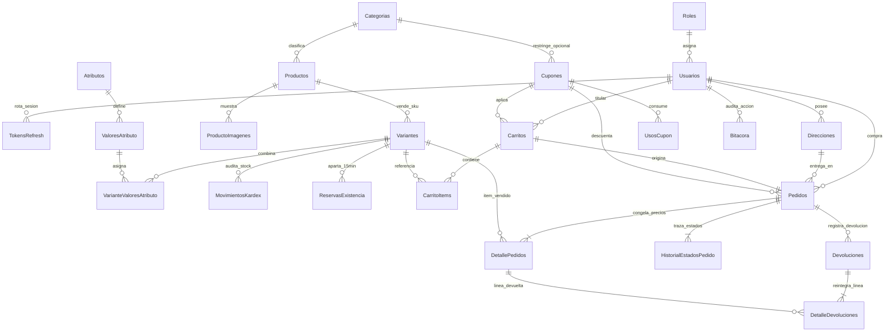
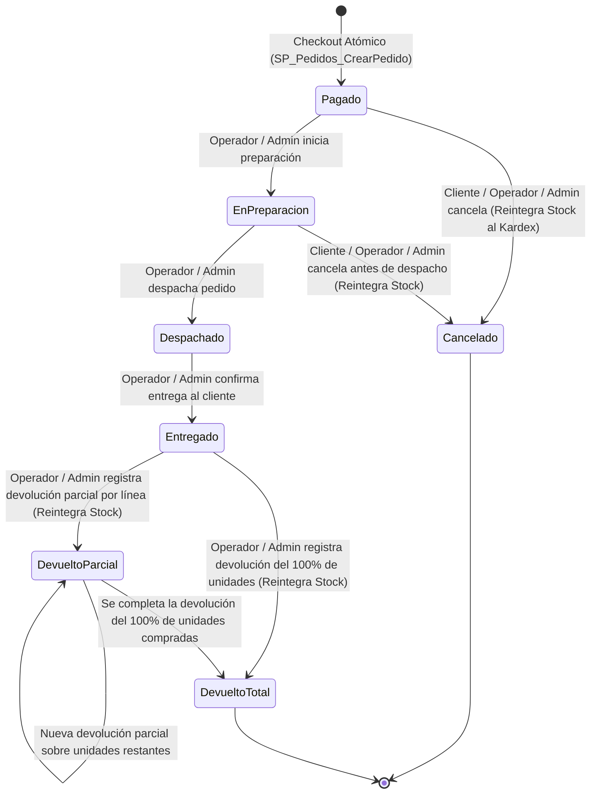

# ShopCart — Plataforma Web de Ventas (Tech Challenge 360 · Grupo Pentandra / Don Arturo)

Plataforma de comercio electrónico de nivel productivo diseñada bajo una arquitectura estricta orientada a la integridad transaccional en **Microsoft SQL Server 2019/2022** (con acceso 100% mediante **Stored Procedures**) y **Backend en Capas con Node.js 24 LTS + TypeScript (`strict`) + Express**.

---

## Tabla de Contenidos
1. [Requisitos Previos e Instalación en Máquina Limpia](#1-requisitos-previos-e-instalación-en-máquina-limpia)
2. [Credenciales de Prueba (Datos Semilla)](#2-credenciales-de-prueba-datos-semilla)
3. [Arquitectura del Sistema y Justificación del Stack](#3-arquitectura-del-sistema-y-justificación-del-stack)
4. [Modelo de Datos y Diagrama Entidad-Relación (3FN)](#4-modelo-de-datos-y-diagrama-entidad-relación-3fn)
5. [Ciclo de Vida del Pedido y Diagrama de Estados (RF-07)](#5-ciclo-de-vida-del-pedido-y-diagrama-de-estados-rf-07)
6. [Decisiones Abiertas Documentadas (Sección 6 del Reto)](#6-decisiones-abiertas-documentadas-sección-6-del-reto)
7. [Estrategias de Concurrencia, Idempotencia e Integridad](#7-estrategias-de-concurrencia-idempotencia-e-integridad)
8. [Catálogo de Endpoints REST API](#8-catálogo-de-endpoints-rest-api)

---

## 1. Requisitos Previos e Instalación en Máquina Limpia

### Requisitos
* **Docker Desktop** (para levantar Microsoft SQL Server 2022) o una instancia local de **SQL Server 2019+**.
* **Node.js 24 LTS** o superior.

### Paso a Paso de Ejecución

```bash
# 1. Copiar variables de entorno y ajustar si es necesario
cp .env.example .env

# 2. Levantar el contenedor de Microsoft SQL Server 2022
docker compose up -d

# 3. Ejecutar los 11 scripts SQL numerados (Esquema, Constraints, Índices, Triggers, Vistas, Funciones, SPs y Semillas)
./database/run-migrations.sh

# 4. Instalar dependencias del Backend e iniciar el servidor en modo desarrollo
cd backend
npm install
npm run dev
```

* El API estará disponible en `http://localhost:4000/api/health` y la documentación interactiva de rutas en `http://localhost:4000/api/docs`.
* Para ejecutar la **suite automatizada de pruebas de integración y concurrencia** (que valida `RF-01` a `RF-09`):

```bash
cd backend
npm run test:integration
```

---

## 2. Credenciales de Prueba (Datos Semilla)

Todos los usuarios semilla tienen contraseñas almacenadas con hash `bcrypt` (`10` salt rounds):

| Rol | Correo Electrónico | Contraseña | Nombre | Estado |
| :--- | :--- | :--- | :--- | :---: |
| **Administrador** | `admin@shopcart.com.gt` | `Admin123!` | Arturo Castillo | Activo (`1`) |
| **Operador** | `operador@shopcart.com.gt` | `Operador123!` | Sofía Morales | Activo (`1`) |
| **Cliente 1** | `cliente@shopcart.com.gt` | `Cliente123!` | Jorge López | Activo (`1`) |
| **Cliente 2** | `maria.garcia@correo.gt` | `Cliente123!` | María Fernanda García | Activo (`1`) |
| **Cliente 3** | `carlos.mendez@correo.gt` | `Cliente123!` | Carlos Eduardo Méndez | Activo (`1`) |
| **Cliente Inactivo** | `inactivo@correo.gt` | `Cliente123!` | Roberto Pérez | Desactivado (`0`) |

### Cupones Semilla Disponibles (`RF-05`)
* `BIENVENIDA10`: **10% de descuento** en todo el carrito (compra mínima `Q150.00`).
* `QUETZAL50`: **Q50.00 de descuento fijo** en todo el carrito (compra mínima `Q300.00`).
* `MODA20`: **20% de descuento** exclusivo para productos de la categoría **Ropa y Moda** (compra mínima `Q200.00`).
* `ULTIMO1`: **Q25.00 de descuento fijo** con `LimiteUsoTotal = 1` (para pruebas de concurrencia de cupón).
* `VENCIDO2025`: Cupón vencido (para probar el mensaje específico de rechazo por vigencia).

---

## 3. Arquitectura del Sistema y Justificación del Stack

### Capas del Backend (`backend/src/`)
1. **Capa de Presentación (`routes/` y `controllers/`):** Maneja exclusivamente el protocolo HTTP, validación de esquemas de entrada mediante `Zod`, extracción de usuario autenticado y envío de respuestas. **Cero lógica de negocio en controladores.**
2. **Capa de Aplicación / Negocio (`services/`):** Orquesta reglas de dominio, cifrado `bcryptjs`, firma y rotación de tokens JWT, caché de reportes y notificaciones en tiempo real (SSE).
3. **Capa de Acceso a Datos (`repositories/`):** Invoca **exclusivamente Stored Procedures (`dbo.SP_Modulo_Proceso`)** mediante `request.input()` con tipos de datos SQL explícitos (`sql.Int`, `sql.Decimal(12,2)`, `sql.NVarChar`) y `request.execute()`. No existe ningún ORM ni una sola sentencia SQL (`SELECT`, `INSERT`, `UPDATE`, `DELETE`) en el código TypeScript.

### Justificación de Librerías en el Backend
* **`express` + `typescript` (`strict: true`):** Tipado estático riguroso y estructura modular de middlewares.
* **`mssql`:** Driver nativo para SQL Server con soporte de pool de conexiones y parámetros tipados contra SQL Injection.
* **`zod`:** Validación declarativa de esquemas en `body`, `query` y `params`.
* **`jsonwebtoken` + `bcryptjs`:** Autenticación stateless de corta duración (`15m`) combinada con Refresh Tokens persistidos en base de datos con hash SHA-256 y rotación por familia.
* **`helmet`, `cors`, `express-rate-limit`:** Seguridad de cabeceras HTTP, control de orígenes y protección contra fuerza bruta en endpoints de autenticación.

---

## 4. Modelo de Datos y Diagrama Entidad-Relación (3FN)

El modelo relacional consta de **25 tablas normalizadas en Tercera Forma Normal (3FN)**, **5 Vistas (`VW_`)**, **4 Funciones Tipo Tabla (`FU_`)**, **49 Stored Procedures (`SP_`)** y **3 Triggers de Inmutabilidad (`TR_`)**.

* **Precisión Monetaria e Impuestos:** Todos los montos están expresados en **Quetzales (`GTQ`)** utilizando `DECIMAL(12, 2)`, los porcentajes usan `DECIMAL(5, 2)` y las unidades de inventario usan `INT`. **Existen 0 columnas `FLOAT` o `REAL`.** Los precios publicados incluyen el **12% de IVA**.



### Apego al Estándar de Nomenclatura de Base de Datos (Sección 5)
* **Llaves Primarias:** `IDRol`, `IDUsuario`, `IDTokenRefresh`, `IDDireccion`, `IDCategoria`, `IDProducto`, `IDProductoImagen`, `IDVariante`, `IDAtributo`, `IDValorAtributo`, `IDVarianteValorAtributo`, `IDCupon`, `IDCarrito`, `IDCarritoItem`, `IDReservaExistencia`, `IDPedido`, `IDDetallePedido`, `IDUsoCupon`, `IDTransicionEstado`, `IDHistorialEstadoPedido`, `IDDevolucion`, `IDDetalleDevolucion`, `IDMovimientoKardex`, `IDBitacora`, `IDConfiguracion`.
* **Stored Procedures (`SP_Modulo_Proceso`):** Incluye exactamente `SP_Pedidos_CrearPedido`, `SP_Inventario_ReservarExistencia`, y 47 procedimientos adicionales organizados por módulo (`SP_Auth_*`, `SP_Usuarios_*`, `SP_Direcciones_*`, `SP_Catalogo_*`, `SP_Inventario_*`, `SP_Carrito_*`, `SP_Cupones_*`, `SP_Pedidos_*`, `SP_Dashboard_*`, `SP_Bitacora_*`).
* **Vistas (`VW_Modulo_Proceso`):** `VW_Dashboard_VentasPorCategoria`, `VW_Pedidos_Historial`, `VW_Inventario_ExistenciaDisponible`, `VW_Inventario_Kardex`, `VW_Dashboard_CarritosAbandonados`.
* **Funciones Tipo Tabla (`FU_Modulo_Proceso`):** `FU_Catalogo_PrecioVigente`, `FU_Cupones_CalculoDescuento`, `FU_Carrito_ResumenTotales`, `FU_Dashboard_TopProductosPeriodo`.

---

## 5. Ciclo de Vida del Pedido y Diagrama de Estados (RF-07)

El ciclo de vida del pedido está gobernado tanto en el Backend como en la tabla `dbo.TransicionesEstadoPedido` dentro de SQL Server y validado por `dbo.SP_Pedidos_CambiarEstado` y `dbo.SP_Pedidos_RegistrarDevolucion`:



### Reglas de Transición Protegidas en Base de Datos
1. **Cancelación (`Cancelado`):** Permitida únicamente desde `Pagado` o `EnPreparacion` (mientras no haya sido despachado). Al cancelar, el SP reintegra automáticamente las unidades a `Variantes.ExistenciaFisica`, inserta los movimientos `'REINGRESO_CANCELACION'` en `MovimientosKardex` y libera el uso del cupón (`UsosCupon`).
2. **Devolución (`DevueltoParcial` / `DevueltoTotal`):** Permitida únicamente sobre pedidos en estado `Entregado` o `DevueltoParcial`. El constraint `CK_DetallePedidos_LimiteDevolucion` (`CantidadDevuelta <= CantidadComprada`) y el SP garantizan que jamás se devuelva más cantidad de la vendida en cada línea.

---

## 6. Decisiones Abiertas Documentadas (Sección 6 del Reto)

El enunciado deja abiertas decisiones de diseño que hemos resuelto y documentado explícitamente:

1. **DA-01 — Fusión del Carrito de Invitado al Autenticarse (`RF-04`):**
   * Un visitante sin sesión opera un carrito identificado por el header `x-guest-token` (`TokenInvitado`). Cuando inicia sesión o se registra enviando dicho token, se ejecuta `SP_Carrito_FusionarInvitado`, que transfiere y suma sus ítems al carrito del usuario autenticado (topando cada variante al máximo de su `ExistenciaDisponible` vigente) y marca el carrito invitado como `'FUSIONADO'`.
2. **DA-02 — Prorrateo Exacto de Descuentos de Cupón en Devoluciones Parciales (`RF-05` / `RF-07` / `RF-08`):**
   * Cuando un pedido utiliza un cupón de descuento, `SP_Pedidos_CrearPedido` prorratea el descuento proporcionalmente entre las líneas elegibles (`DescuentoProporcionalLinea`) ajustando cualquier residuo de `Q0.01` en la línea de mayor valor para que `SUM(TotalLineaNeto) == Pedido.Total`. Así, si el cliente devuelve parcialmente 1 unidad de una línea, el reintegro monetario se calcula exactamente sobre el monto neto pagado por esa unidad y no sobre el precio de lista bruto.
3. **DA-03 — Liberación del Uso de Cupón en Cancelaciones Pre-Despacho (`RF-05` / `RF-07`):**
   * Si un pedido que utilizó un cupón es **Cancelado** antes de ser despachado, se desactiva el registro en `UsosCupon` y se decrementa `Cupones.UsosActuales` para que el cliente no pierda su derecho al cupón por una compra cancelada. En devoluciones posteriores a la entrega, el cupón se considera consumido.
4. **DA-04 — Checkout en Dos Pasos con Reserva de 15 Minutos (`RF-06`):**
   * **Paso 1 (`POST /api/checkout/reserve` -> `SP_Inventario_ReservarExistencia`):** Bloquea y aparta las unidades del carrito durante 15 minutos, devolviendo un `TokenReserva` y la `FechaExpiracion`.
   * **Paso 2 (`POST /api/checkout/confirm` -> `SP_Pedidos_CrearPedido`):** Consume la reserva activa validando la `ClaveIdempotencia`, descuenta la existencia física en el Kardex y congela los precios del pedido en una sola transacción.
5. **DA-05 — Criterio de "Pedidos Completados" en Reportes del Dashboard (`RF-08`):**
   * Los reportes consideran todos los pedidos cuyo pago fue confirmado y que no han sido cancelados (`Pagado`, `EnPreparacion`, `Despachado`, `Entregado`, `DevueltoParcial`, `DevueltoTotal`), excluyendo por completo los `Cancelado` y restando de las ventas brutas el monto reintegrado por devoluciones (`Total - MontoReintegradoAcumulado`).
6. **DA-06 — Simulación Determinista de Pasarela de Pago (`RF-06`):**
   * El endpoint `POST /api/checkout/confirm` acepta el flag opcional `simularFalloPago: true` para demostrar en vivo durante la defensa técnica qué ocurre cuando un cobro falla (se rechaza con HTTP `402` sin crear el pedido ni descontar el Kardex, manteniendo la reserva temporal hasta su expiración).

---

## 7. Estrategias de Concurrencia, Idempotencia e Integridad

* **Cero Sobreventa bajo Concurrencia (`RF-06`):** En `SP_Inventario_ReservarExistencia` y `SP_Pedidos_CrearPedido`, las filas de `dbo.Variantes` se bloquean dentro de una transacción con `WITH (UPDLOCK, HOLDLOCK)` siempre en **orden ascendente de `IDVariante`**. Esto serializa el acceso a la última unidad disponible y elimina matemáticamente la posibilidad de *deadlocks*.
* **Liberación Automática de Reservas Vencidas (`RF-07`):** Implementada con doble garantía:
  1. **Evaluación Lazy Instantánea:** `FU_Catalogo_PrecioVigente` y `VW_Inventario_ExistenciaDisponible` calculan las unidades reservadas filtrando `EstadoReserva = 'ACTIVA' AND FechaExpiracion > SYSDATETIME()`. En el instante exacto en que se cumplen los 15 minutos, la existencia vuelve a estar disponible sin demora.
  2. **Limpieza Proactiva:** Un job ligero cada 60 segundos en el servidor y cada inicio de checkout invocan `SP_Inventario_LiberarReservasVencidas` para actualizar el estado a `'EXPIRADA'`.
* **Idempotencia en Pagos (`RF-06`):** La columna `Pedidos.ClaveIdempotencia` posee una restricción `UNIQUE` (`UQ_Pedidos_ClaveIdempotencia`). Si el cliente presiona dos veces el botón de pagar o reintenta por falla de red con la misma `ClaveIdempotencia`, `SP_Pedidos_CrearPedido` detecta el registro previo dentro del bloqueo transaccional y devuelve el pedido ya creado sin duplicar el cobro ni el movimiento de inventario.
* **Inmutabilidad de Bitácora y Kardex (`RF-03` y `RF-09`):** Los triggers `TR_Bitacora_BloquearModificacionYEliminacion`, `TR_MovimientosKardex_BloquearModificacionYEliminacion` y `TR_HistorialEstadosPedido_BloquearModificacionYEliminacion` (`INSTEAD OF UPDATE, DELETE`) rechazan con error `50099` cualquier intento de alterar o borrar registros históricos.

---

## 8. Catálogo de Endpoints REST API

| Módulo | Método y Ruta | Rol Requerido | Stored Procedure Invocado |
| :--- | :--- | :---: | :--- |
| **Auth** | `POST /api/auth/register` | Público | `SP_Auth_RegistrarCliente` + `SP_Carrito_FusionarInvitado` |
| **Auth** | `POST /api/auth/login` | Público | `SP_Auth_ObtenerUsuarioPorCorreo` + `SP_Auth_GuardarRefreshToken` |
| **Auth** | `POST /api/auth/refresh` | Público | `SP_Auth_RotarRefreshToken` |
| **Auth** | `POST /api/auth/logout` | Público / Auth | `SP_Auth_RevocarRefreshToken` |
| **Auth** | `GET /api/auth/me` | Autenticado | `SP_Usuarios_ObtenerPorID` |
| **Usuarios** | `GET /api/users` | Administrador | `SP_Usuarios_Listar` |
| **Usuarios** | `POST /api/users` | Administrador | `SP_Usuarios_CrearInterno` |
| **Usuarios** | `PUT /api/users/:id` | Administrador | `SP_Usuarios_Actualizar` |
| **Usuarios** | `PATCH /api/users/:id/status` | Administrador | `SP_Usuarios_CambiarEstadoActivo` |
| **Direcciones** | `GET /api/addresses` | Cliente | `SP_Direcciones_ListarPorCliente` |
| **Direcciones** | `POST /api/addresses` | Cliente | `SP_Direcciones_Crear` |
| **Direcciones** | `PUT /api/addresses/:id` | Cliente (Dueño) | `SP_Direcciones_Actualizar` |
| **Direcciones** | `DELETE /api/addresses/:id` | Cliente (Dueño) | `SP_Direcciones_Eliminar` |
| **Catálogo** | `GET /api/categories` | Público | `SP_Catalogo_ListarCategorias` |
| **Catálogo** | `POST /api/categories` | Administrador | `SP_Catalogo_CrearCategoria` |
| **Catálogo** | `PUT /api/categories/:id` | Administrador | `SP_Catalogo_ActualizarCategoria` |
| **Catálogo** | `GET /api/products` | Público | `SP_Catalogo_ListarProductos` |
| **Catálogo** | `GET /api/products/:id` | Público | `SP_Catalogo_ObtenerProductoDetalle` |
| **Catálogo** | `POST /api/products` | Administrador | `SP_Catalogo_CrearProducto` |
| **Catálogo** | `PUT /api/products/:id` | Administrador | `SP_Catalogo_ActualizarProducto` |
| **Catálogo** | `DELETE /api/products/:id` | Administrador | `SP_Catalogo_EliminarODesactivarProducto` |
| **Variantes** | `POST /api/products/:idProducto/variants` | Administrador | `SP_Catalogo_GuardarVariante` |
| **Variantes** | `PUT /api/products/:idProducto/variants/:idVariante` | Administrador | `SP_Catalogo_GuardarVariante` |
| **Inventario** | `GET /api/inventory/stock` | Operador / Admin | `SP_Inventario_ObtenerExistencias` |
| **Inventario** | `GET /api/inventory/kardex` | Operador / Admin | `SP_Inventario_ConsultarKardex` |
| **Inventario** | `POST /api/inventory/movements` | Operador / Admin | `SP_Inventario_RegistrarMovimiento` |
| **Carrito** | `GET /api/cart` | Público / Cliente | `SP_Carrito_ObtenerDetalle` |
| **Carrito** | `POST /api/cart/items` | Público / Cliente | `SP_Carrito_AgregarOModificarItem` |
| **Carrito** | `DELETE /api/cart/items/:idVariante` | Público / Cliente | `SP_Carrito_EliminarItem` |
| **Carrito** | `POST /api/cart/merge` | Cliente | `SP_Carrito_FusionarInvitado` |
| **Cupones** | `POST /api/cart/coupon` | Público / Cliente | `SP_Carrito_AplicarCupon` |
| **Cupones** | `GET /api/coupons` | Administrador | `SP_Cupones_Listar` |
| **Cupones** | `POST /api/coupons` | Administrador | `SP_Cupones_Guardar` |
| **Checkout** | `POST /api/checkout/reserve` | Cliente | `SP_Inventario_ReservarExistencia` |
| **Checkout** | `POST /api/checkout/confirm` | Cliente | `SP_Pedidos_CrearPedido` |
| **Pedidos** | `GET /api/orders` | Autenticado | `SP_Pedidos_Listar` |
| **Pedidos** | `GET /api/orders/:id` | Dueño / Op / Admin | `SP_Pedidos_ObtenerDetalle` |
| **Pedidos** | `PATCH /api/orders/:id/state` | Dueño / Op / Admin | `SP_Pedidos_CambiarEstado` |
| **Devoluciones**| `POST /api/orders/:id/returns` | Operador / Admin | `SP_Pedidos_RegistrarDevolucion` |
| **Dashboard** | `GET /api/dashboard/metrics` | Operador / Admin | `SP_Dashboard_ObtenerMetricas` |
| **Dashboard** | `GET /api/dashboard/export` | Operador / Admin | `SP_Dashboard_ObtenerMetricas` (CSV/Excel) |
| **Dashboard** | `GET /api/dashboard/stream` | Operador / Admin | Server-Sent Events (Tiempo Real) |
| **Dashboard** | `GET /api/dashboard/abandoned-carts` | Operador / Admin | `SP_Dashboard_ListarCarritosAbandonados` |
| **Bitácora** | `GET /api/audit-logs` | Administrador | `SP_Bitacora_Listar` |
